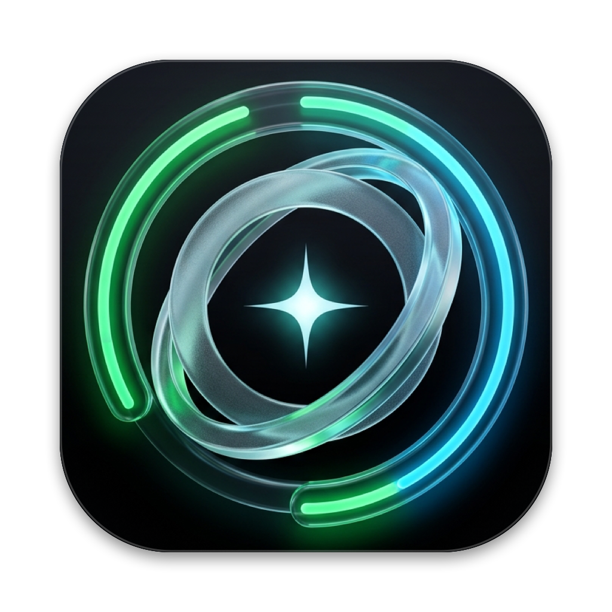
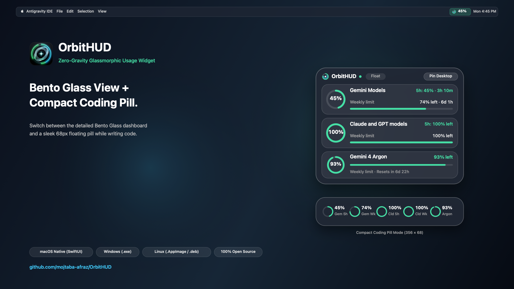

<div align="center">
  

  <h1>OrbitHUD</h1>
  <p><strong>Never hit a 5-hour AI rate limit mid-flow again.</strong></p>
  <p>
    A native <strong>macOS (SwiftUI)</strong> &amp; cross-platform (<strong>Windows / Linux</strong>) glassmorphic desktop HUD that tracks your live <strong>Google Antigravity</strong>, <strong>Claude Code</strong>, and <strong>OpenAI Codex CLI</strong> quotas — with proactive smart alerts, SHA256-verified auto-updates, and zero telemetry.
  </p>

  <p>
    <a href="https://mojtaba-afraz.github.io/OrbitHUD/"></a>
    <a href="../../releases/latest/download/OrbitHUD-macOS.dmg"></a>
    <a href="../../releases/latest/download/OrbitHUD-Windows-Setup.exe"></a>
    <a href="../../releases/latest/download/OrbitHUD-Linux-x86_64.AppImage"></a>
  </p>

  <p>
    <a href="../../releases/latest"></a>
    <a href="../../releases"></a>
    <a href="../../releases/latest"></a>
    
    
    
  </p>
</div>

---

<div align="center">
  
  <br />
  <sub><strong>Full Bento Glass View</strong> &amp; <strong>52px Compact Coding Pill</strong> — live 5h &amp; weekly gauges across Antigravity, Claude Code, and Codex CLI.</sub>
</div>

---

## ⚡ Why OrbitHUD?

Coding with AI agents is effortless — until a silent 5-hour quota wall interrupts you mid-refactor. OrbitHUD keeps your remaining runway visible at a glance and alerts you *before* you hit zero.

| Capability | What You Get |
| :--- | :--- |
| **🍎 True Native macOS App** | Built in **Swift & SwiftUI** with real `NSVisualEffectView` behind-window blur — tiny RAM/CPU footprint (not an Electron wrapper on macOS). |
| **🔔 Smart Quota Alerts & Reset Notifications** | Opt-in native OS notifications (`UNUserNotificationCenter` / Electron `Notification`) when any visible bucket drops below your threshold (`20%`, `15%`, `10%`, `5%`) **and** when your 5h/weekly window resets back to `100%` — with per-cycle anti-spam deduplication. |
| **🧩 Unified Multi-Provider HUD** | Connects locally to **Google Antigravity** (`127.0.0.1`) out of the box, with opt-in support for **Claude Code** and **OpenAI Codex CLI**, segmented provider filter tabs, and instant logout / account-switch detection. |
| **🔄 SHA256-Verified Auto-Updater** | Automatic GitHub Releases update detection, live download progress banner, fail-closed **SHA256 verification** against `SHA256SUMS.txt`, and one-click relaunch on **macOS, Windows, and Linux**. |
| **🪟 3 Display Modes + 52px Coding Pill** | Switch between **Floating HUD** (always-on-top across spaces), **Desktop Widget** (pinned to wallpaper with position lock), and **Menu Bar / System Tray** — or collapse into a 52px Compact Pill while coding. |
| **🛡 Built for Daily Reliability** | **Launch at Login**, **Multi-Monitor off-screen recovery**, per-model Hide/Show toggles, and live file-system watchers for zero-lag updates. |

---

## 📥 Quick Install

### Package Managers *(Recommended)*

**🍎 macOS (Homebrew Cask):**
```bash
brew tap mojtaba-afraz/tap
brew install --cask --no-quarantine orbithud
```

**🪟 Windows (WinGet):**
```powershell
winget install MojtabaAfraz.OrbitHUD
```

**🐧 Arch Linux (AUR):**
```bash
yay -S orbithud-bin
```

### Direct Downloads

| Platform | Installer | Notes |
| :--- | :--- | :--- |
| **🍎 macOS** *(Apple Silicon & Intel)* | [**`OrbitHUD-macOS.dmg`**](../../releases/latest/download/OrbitHUD-macOS.dmg) · [**`OrbitHUD-macOS.zip`**](../../releases/latest/download/OrbitHUD-macOS.zip) | Native Universal SwiftUI app (`macOS 13+`) |
| **🪟 Windows** *(10 / 11 x64)* | [**`OrbitHUD-Windows-Setup.exe`**](../../releases/latest/download/OrbitHUD-Windows-Setup.exe) · [**`Portable.exe`**](../../releases/latest/download/OrbitHUD-Windows-Portable.exe) | System Tray + Floating/Desktop HUD |
| **🐧 Linux** *(Ubuntu / Debian / Arch / Fedora)* | [**`OrbitHUD-Linux-x86_64.AppImage`**](../../releases/latest/download/OrbitHUD-Linux-x86_64.AppImage) · [**`OrbitHUD-Linux-amd64.deb`**](../../releases/latest/download/OrbitHUD-Linux-amd64.deb) | Standalone AppImage or `.deb` package |

<details>
<summary><strong>⚡ One-Command Terminal Installers &amp; macOS First-Launch Gatekeeper Note</strong></summary>

<br />

**macOS & Linux:**
```bash
curl -fsSL https://raw.githubusercontent.com/mojtaba-afraz/OrbitHUD/main/scripts/install.sh | bash
```

**Windows (PowerShell):**
```powershell
irm https://raw.githubusercontent.com/mojtaba-afraz/OrbitHUD/main/scripts/install.ps1 | iex
```

> **macOS First Launch ("Apple could not verify OrbitHUD.app"):** OrbitHUD is open-source and ad-hoc signed without a paid Apple Developer ID certificate. If Gatekeeper blocks first launch, install via Homebrew `--no-quarantine` or the terminal installer above, or run:
> ```bash
> xattr -dr com.apple.quarantine /Applications/OrbitHUD.app
> ```

</details>

---

## 🔒 Privacy & Security First

OrbitHUD is designed for developers who care deeply about what touches their credentials:

| Area | Behavior |
| :--- | :--- |
| **Google Antigravity (Default)** | 100% local loopback (`127.0.0.1`) to your running Antigravity Language Server. Zero external API calls, zero API keys. |
| **Claude Code & Codex CLI (Opt-In)** | Disabled by default. When enabled in **Settings → Providers**, reads local CLI credentials (`macOS Keychain` / `~/.claude/.credentials.json` or `~/.codex/auth.json`) strictly to query official usage endpoints. |
| **Auto-Updates** | Queries GitHub Releases (`api.github.com`) and **enforces fail-closed SHA256 verification** against `SHA256SUMS.txt` before installing — any mismatch aborts and deletes the download. |
| **Telemetry & Tracking** | **Zero.** No analytics SDKs, no crash reporters, no third-party servers. |

---

## 🗺 Roadmap & Contributing

OrbitHUD is actively developed in the open — see what's shipped and what's next in [**ROADMAP.md**](ROADMAP.md):

- ✅ **Native macOS Auto-Updater** with SHA256 verification ([#1](../../issues/1))
- ✅ **Smart Quota Alerts & Reset Notifications** across macOS, Windows & Linux ([#4](../../issues/4))
- ✅ **Release Download Analytics** via GitHub API, zero telemetry ([#11](../../issues/11))
- ⬜ **Next up (`v1.3.0` / `v1.4.0`):** Refresh Interval UI ([#2](../../issues/2)), Configurable Menu Bar/Tray Primary Model ([#3](../../issues/3)), Global Hotkey ([#5](../../issues/5)), Burn-Rate & 7-Day Token Analytics Drawer ([#6](../../issues/6)), Cursor/Copilot/OpenRouter Providers ([#7](../../issues/7)), Glassmorphic Themes ([#8](../../issues/8))

Want to contribute? Browse [`good first issue`](../../labels/good%20first%20issue) or [`help wanted`](../../labels/help%20wanted) and open a Pull Request!

<details>
<summary><strong>🛠 For Developers: Building from Source &amp; Running Tests</strong></summary>

<br />

```bash
# Run native Swift unit tests
swift test

# Build Universal macOS .app bundle (.dmg / .zip via package_macos_release.sh)
./scripts/build_app.sh

# Run cross-platform unit tests & build Windows/Linux packages
cd cross-platform
npm install
npm test
npm run dist:win
npm run dist:linux
```

All release installers and `SHA256SUMS.txt` are automatically built and published by [`.github/workflows/release.yml`](.github/workflows/release.yml) on every `v*.*.*` tag push.

</details>

---

<div align="center">
  <p>Released under the <a href="LICENSE">MIT License</a> · Built for developers who live in their IDE.</p>
</div>
